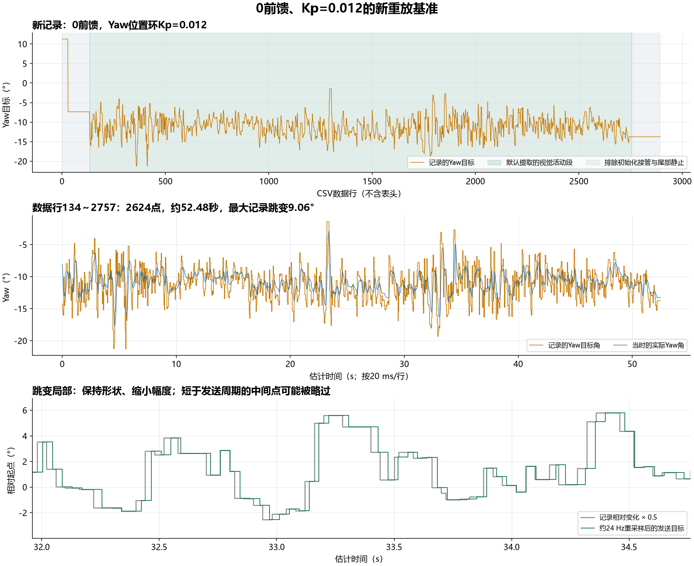

# 用实测目标调Yaw

当前重放基准来自 `vofa+5_37436-40329.csv`。用户说明采集时两个Yaw前馈增益均为0，Yaw位置环Kp为0.012。旧的 `vofa+3_31023-40329.csv` 受超调云台反馈影响，已从活动控件中移除，保存在 `archive/vofa3-superseded-20261023/`，不再作为调参基准。

控件名仍为“实测视觉Yaw重放”，界面会显示 **新基准：0前馈，Yaw位置环Kp=0.012**。无需修改或重新烧录固件。

## 新记录的检查结果

原件2894行、12通道，没有时间戳。读取第四列 **Yaw目标角（°）**，不使用实际角或门控误差冒充指令。前后静止区和起始接管过程已排除：

- 第29行目标从11.250343°跳到−7.355571°，是约18.61°的起始接管；之后保持到第133行。
- 默认使用**数据行134～2757**（不含表头，首尾都保留），最后一段停止接收后的静止记录不进入默认重放。
- 实际角差与上传速度交叉估算为 **19.854 ms/行**，因此默认周期取20 ms。仍属于估计值，不是硬件时间戳。
- 记录中速度环目标与“Yaw角误差 × 12”吻合，拟合Kp约0.0120000002，支持用户说明的位置环/速度前馈基线。输出前馈和插值开关没有独立硬件读回列。

| 项目 | 数值 |
| --- | ---: |
| 默认片段 | 数据行134～2757 |
| 采样点 | 2624 |
| 估计时长 | 52.48 s |
| 原Yaw目标范围 | −21.275673～−1.439253° |
| 记录中的目标变化次数 | 1049 |
| 最大单次目标跳变 | 9.063998° |
| CAN在线标志为0的采样 | 14点 |
| Yaw门控阈值为0的采样 | 26点 |
| 在线时绝对跟踪误差中位数 | 1.411° |
| 在线时跟踪误差RMS | 2.263° |
| 在线时最大绝对跟踪误差 | 10.767° |
| 电机输出触及±30000限幅 | 0点 |

误差直接用目标角和实际角相减并回绕计算；门控为0的行也没有被当成误差0。新基准用于固定输入对照，不表示视觉目标已被独立测量为真值。瞬时大误差原样保留，未做平滑或挑选性删除。



## 开始一轮对照

1. 保存当前VOFA采样，遥控退出自瞄，断开串口；更新控件后手动重启VOFA。
2. 从控件栏拖入 **实测视觉Yaw重放**；背景右键 → 绑定数据 → **I2：Yaw实际角**，I2增益1、偏置0。
3. 串口使用现有115200、8N1、JustFloat，等待遥测更新，再按原流程进入自瞄。
4. 第一轮选“完整基准段”、**幅度比例0.5**、**记录采样周期20 ms**。起点相对变化约−3.50～+6.42°，最大相邻发送跳变约4.53°。
5. 点“开始重放”，观察I3目标角与I2实际角。到时自动结束，保持最后目标，不自动回中。
6. 先在**0前馈、Kp=0.012**下记录一次重放结果，作为这一套发送方式的基线。随后保持片段、比例、周期和初始姿态一致，每次只改一个控制参数。
7. 结束后遥控退出自瞄，再恢复CAN来源。下一轮前保存并清空VOFA旧采样。

也提供“前段跟踪”（数据行134～633，约10 s）和“密集跳变段”（1701～2200，约10 s），便于快速重复。原始实测与半幅、重新居中的重放工况不同；调参结论应优先比较**相同重放输入**下的两轮结果。

## 目标如何生成

```text
指令Yaw = 本轮开始时的实际Yaw + 幅度比例 × (记录Yaw − 所选片段首个Yaw)
```

比例1保留原角度变化，只平移起点；比例0.5等比例减半。超过±180°时按原协议回绕。不平滑，不拟合正弦，不补造随机噪声。Pitch保持已有目标。开始重放不会修改Kp、前馈增益或插值开关，按调试器中的当前值运行。

控件每42 ms请求发送一次 `yaw:角度`，按当时进度取最近已到达的记录采样值，保持到下一次发送。按20 ms记录周期计算，1049次目标变化重采样后约993次，最大相邻发送跳变约9.064°（比例1）。部分短于发送周期的中间点会被略过。这是**实测轨迹的约24 Hz模拟**，不是原始CAN逐帧重放；QML定时器和串口队列还会产生抖动。

开始只发送一次来源切换请求，随后只发Yaw目标，沿用固件已有的串口模拟路径。该路径fire为0，禁止模拟开火。前馈启用时，固件根据相邻串口帧重新估计目标速度；不会使用板端正弦的解析速度。

CSV没有原始帧时间、fire/rev和插值开关记录。如果录制时开启了插值，记录的是插值后的控制目标；无法据此恢复原始视觉帧。重放也不包含实际发射的机械扰动，重复轨迹调好后仍需真实视觉和打弹验证。

控件请求 `stream:20`，目标命令还会产生额外遥测回帧。普通Δt时间轴仅用于近似观察，不能直接从后续无时间戳CSV计算精确延迟。

## 更换后续片段

本次准备命令：

```powershell
python -X utf8 tools/prepare_vision_replay.py "vofa+5_37436-40329.csv" --first 134 --last 2757 --sample-ms 20 --profile "前段跟踪:134:633" --profile "密集跳变段:1701:2200" --baseline-label "新基准：0前馈，Yaw位置环Kp=0.012"
```

开始/结束行必须显式指定，不能沿用另一份CSV的行号。命令生成 `vision_replay/recording.js` 和分析JSON，不改原件。随后运行 `install_replay.cmd` 或 `install_replay.ps1`，再手动重启VOFA。安装脚本只复制控件并保留旧安装副本，不关软件、不发送命令、不覆盖正弦控件。

新原件SHA256：`f59e73b834166ecf9be9c5a84a7a2c3d822a55cf1ce1921281f9356527efc57a`。

## 验证范围

- 检查提取范围、片段越界、采集参数标签、原件哈希及零值/重复值保留。
- 检查全部2624个目标点的平移、缩放与角度回绕。
- 运行真实控件的按钮和定时器代码，检查手动启动、只接管一次、到时结束、停止不回中、断连/遥测超时/界面卡顿停止。
- 不修改固件、PID、前馈或开火参数。离线测试与文件安装不代表实机重放和控制效果已验证。
